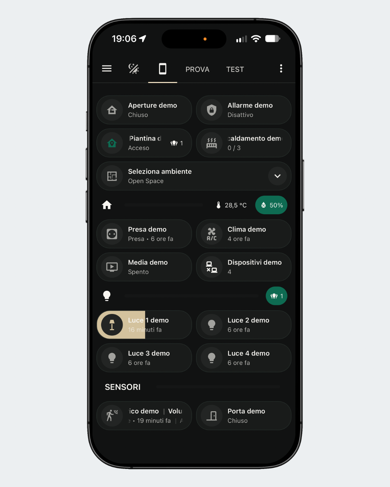
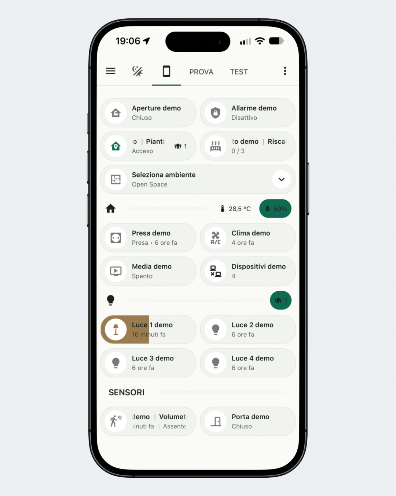
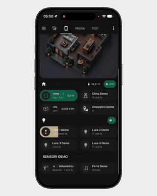
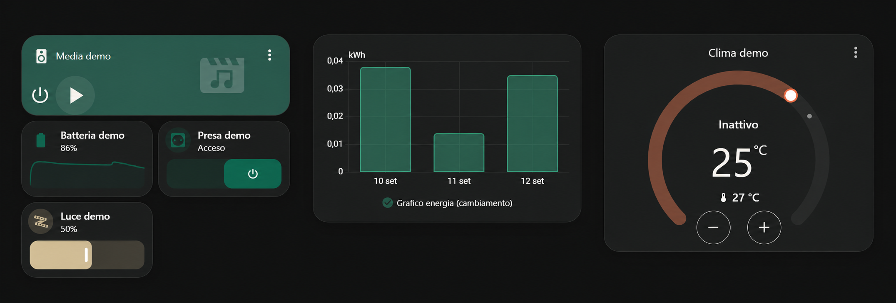
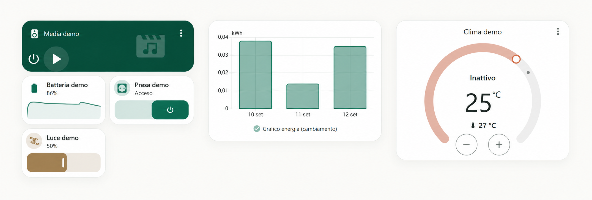

# Edera

## Overview

*Open Home Assistant. Everything else can wait.*

**Edera** is a custom Home Assistant theme featuring two coordinated appearance modes: **Light** and **Graphite Dark**.

Designed for a clean, harmonious, and readable interface, Edera brings consistent visual styling to Home Assistant across smartphones, tablets, and desktop devices.

Its semantic color palette helps distinguish device states and dashboard information without unnecessary visual complexity.

**Light + Graphite Dark · Semantic colors · No required custom dependencies**

## Preview

### Mobile — Light and Graphite Dark

<table width="100%">
  <tr>
    <th width="50%">Graphite Dark</th>
    <th width="50%">Light</th>
  </tr>
  <tr>
    <td width="50%" align="center">
      
    </td>
    <td width="50%" align="center">
      
    </td>
  </tr>
</table>

Edera maintains a consistent visual identity across devices, with particular attention to readability on smaller screens.

### Video demonstration

  

<a href="media/edera-demo.mp4">Watch the video demonstration</a>

### Desktop — Light and Graphite Dark

<table width="100%">
  <tr>
    <th width="50%">Graphite Dark</th>
    <th width="50%">Light</th>
  </tr>
  <tr>
    <td width="50%" align="center">
      
    </td>
    <td width="50%" align="center">
      
    </td>
  </tr>
</table>

**Note:** The screenshots demonstrate example Home Assistant dashboards. Edera changes the appearance of Home Assistant but does not install dashboards, custom cards, or layouts.

## Features

- **Light and Graphite Dark:** Two coordinated appearance modes within a single Home Assistant theme.
- **Semantic colors:** A consistent palette to distinguish device states and interface elements.
- **Responsive design:** Visual styling intended for desktop, smartphone, and tablet interfaces.
- **Card styling:** Coordinated backgrounds, borders, spacing, and visual surfaces.
- **Chart colors:** A matching palette for graphical information.
- **System fonts:** No external web fonts required.
- **Native compatibility:** Designed to work with Home Assistant's built-in interface and cards.
- **Optional customization:** Additional styling variables for compatible third-party cards.
- **No required custom dependencies:** The base theme does not depend on HACS custom cards or additional frontend components.

### Semantic state colors

| State | Color |
|---|---|
| Active device | Emerald |
| Light on | Warm Ivory / Brass |
| Media | Petrol |
| Heating | Terracotta |
| Cooling | Soft Blue |
| Warning | Amber |
| Alarm / Critical problem | Alert Red |
| Off / Inactive | Neutral |

The palette is intended to make dashboard states easier to recognize at a glance.

## Installation

### HACS

Edera can be installed through HACS as a Home Assistant theme.

1. Open **HACS** in Home Assistant.
2. Search for **Edera**.
3. Open the repository and download the theme.
4. If Edera is not yet visible in the catalog, open the HACS menu and select **Custom repositories**.
5. Enter the repository URL:

   `https://github.com/luigi-regolo/Edera`

6. Select **Theme** as the repository type and add it.
7. Find Edera in HACS and download it.
8. Reload themes or restart Home Assistant if necessary.
9. Select **Edera** from your Home Assistant user profile.

### Manual installation

1. Download [edera.yaml](https://raw.githubusercontent.com/luigi-regolo/Edera/main/themes/edera.yaml).
2. Copy the file to your Home Assistant configuration directory:

   `/config/themes/edera.yaml`

3. If themes are not already enabled, add the following configuration to the existing `frontend` configuration in `configuration.yaml`:

~~~yaml
frontend:
  themes: !include_dir_merge_named themes
~~~

4. Reload themes or restart Home Assistant.
5. Select **Edera** from your user profile.

Avoid creating duplicate `frontend` configuration sections if one already exists.

## Configuration and Usage

### Light and Dark modes

Edera includes both appearance modes within the same theme.

- **Light:** A bright interface with soft neutral backgrounds and emerald accents.
- **Graphite Dark:** A darker interface with coordinated surfaces and readable contrast.

After selecting Edera in your Home Assistant profile, choose the preferred Light, Dark, or automatic appearance setting supported by Home Assistant.

### Optional components

Edera works without additional custom cards.

The theme includes styling variables that can be used alongside optional third-party components such as:

- Bubble Card
- Mushroom
- card-mod

These components are independently maintained projects. Compatibility and appearance may vary across versions and Home Assistant updates.

Edera does not install or configure these components automatically.

## Compatibility and Requirements

Edera requires Home Assistant with support for YAML frontend themes and Light/Dark theme modes.

A specific minimum Home Assistant version has not been independently verified for this repository.

The theme:

- Uses Home Assistant frontend theme variables.
- Does not require external fonts.
- Does not require additional JavaScript modules.
- Does not require a dedicated account, subscription, or paid API.
- Does not require third-party custom cards for its base appearance.

Some interface elements or third-party cards may require additional styling adjustments after Home Assistant updates.

## Privacy and Security

Edera is a visual theme defined through Home Assistant YAML configuration.

The theme itself does not implement:

- User tracking or telemetry.
- Direct external API requests.
- Credential or token collection.
- Device control or automation logic.
- Advertising or external font loading.

Home Assistant and installed integrations may use external services according to their own configurations and privacy policies.

The dashboards shown in the previews are demonstrations and are not included as functional dashboard configurations.

## Releases

Download the latest version from [GitHub Releases](https://github.com/luigi-regolo/Edera/releases).

## Copyright & License

Copyright © 2026 luigi-regolo.

Original project created and maintained by **luigi-regolo**.

Licensed under the **GNU General Public License version 3 only (GPL-3.0-only)**.

See the [LICENSE](LICENSE) file for the complete license terms.

The software is provided without warranty to the extent permitted by applicable law.
